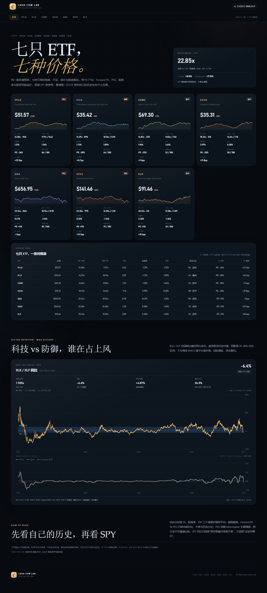

# CASH COW LAB · 七只 ETF 估值罗盘

一个以可视化为主的多 ETF 长期估值站点，包含 **VFLO、IFLO、COWZ、SCHD、QQQ、SOXX、XLP** 七个独立页面，并统一加入 **SPY 对比**、**Forward PE / PEG** 和 **月度季节性**。

每只 ETF 使用**各自可获得的最长日线历史**：XLP 可追到 1998 年，QQQ 到 1999 年，SOXX 到 2001 年，SCHD 到 2011 年，COWZ 到 2016 年；VFLO、IFLO 则从成立日开始。页面默认显示全历史。



## 页面

- `index.html`：七只 ETF 总览与横向对照
- `vflo.html`：VictoryShares Free Cash Flow ETF
- `iflo.html`：VictoryShares International Free Cash Flow ETF
- `cowz.html`：Pacer US Cash Cows 100 ETF
- `schd.html`：Schwab US Dividend Equity ETF
- `qqq.html`：Invesco QQQ Trust
- `soxx.html`：iShares Semiconductor ETF
- `xlp.html`：State Street Consumer Staples Select Sector SPDR ETF

每页包含：价格与回撤、PE-TTM 五档分位、Forward PE / PEG、股息率、ERP、SPY 总回报/相对强弱/股息率对比、当前指标对照表、月度季节性、月度读数日志。

总览页额外加入 **XLK / XLP 总回报比值的同比走势**（最长历史、均值虚线、20–80% 分位区间）和下方 **周线 MACD(12,26,9)**；两张图同步支持滚轮缩放、双击复位。

## 时间范围与滚轮缩放

图表上方提供按可用历史动态生成的时间选项：

```text
1年 · 2年 · 3年 · 5年 · 8年 · 10年 · 15年 · 20年 · 25年 · 全部
```

- 只显示该 ETF 实际覆盖的年数：IFLO 只有 1 年 + 全部，VFLO 到 3 年，COWZ 到 10 年，SCHD 到 15 年，QQQ/SOXX/XLP 到 25 年 + 全部。
- 所有图表的 X 轴同步到同一时间窗口。
- 价格图下方的「区间回报 / 区间年化 / 最大回撤 / 年化波动」也随窗口同步重算。
- 鼠标滚轮在任意图表上可连续缩放；双击图表恢复全历史；`全部` 按钮也可重置。
- 季节性图固定使用**全历史完整月份**，不随窗口变化。
- 总览页的 XLK/XLP 图表使用**复权总回报比值**，同比为 252 个交易日变化；虚线是全历史均值，阴影是 20–80% 分位区间；下方为**周线 MACD(12,26,9)**，柱状图为 MACD − Signal；每周取该周最后一个真实交易日，且 X 轴关闭 offset，避免左右留白。同比需要 252 个交易日，因此曲线从 1999-12 开始。

## 快速开始

```bash
cd etf-compass
python serve.py
# 打开 http://127.0.0.1:8765
```

也可以直接双击 `site/index.html`，或：

```bash
python -m http.server 8765 --directory site
```

## 更新数据

```bash
# 拉取全部 ETF + SPY + 美债 + 标普盈利路径，更新锚点并重建
python scripts/update_data.py

# 只更新行情，保留 PE / Forward PE / PEG 长期增速锚点
python scripts/update_data.py --no-auto-anchors

# 只用本地缓存重建页面
python scripts/build_all.py
```

需要 Python 3.10+、`pandas`、`numpy`。

PE / Forward PE / 长期增速锚点在 `data/raw/anchors.json`：

```json
{
  "VFLO": {"pe": 14.58, "forward_pe": 9.97, "lt_growth": 16.00, "as_of": "2026-11-17"},
  "IFLO": {"pe": 14.29, "forward_pe": 10.76, "lt_growth": 11.35, "as_of": "2026-11-17"},
  "COWZ": {"pe": 14.82, "forward_pe": 11.82, "lt_growth": 11.55, "as_of": "2026-11-17"},
  "SCHD": {"pe": 18.23, "forward_pe": 14.61, "lt_growth": 8.30,  "as_of": "2026-11-17"},
  "QQQ":  {"pe": 25.34, "forward_pe": 18.94, "lt_growth": 24.36, "as_of": "2026-11-17"},
  "SOXX": {"pe": 25.38, "forward_pe": 14.50, "lt_growth": 10.48, "as_of": "2026-11-17"},
  "XLP":  {"pe": 25.33, "forward_pe": 21.28, "lt_growth": 7.36,  "as_of": "2026-11-17"},
  "SPY":  {"pe": 22.85, "forward_pe": 18.38, "lt_growth": 17.75, "as_of": "2026-11-17"}
}
```

自动更新优先读 StockAnalysis，失败时退回 5i Research；长期增速从 Morningstar 组合页刷新，仍失败则保留旧锚点。

## GitHub Actions 自动部署

工作流：[.github/workflows/update-and-deploy.yml](.github/workflows/update-and-deploy.yml)

### 一次性设置

1. 把本目录作为新仓库根目录（建议仓库名 `etf-compass`）：

   ```bash
   cd etf-compass
   git init
   git add .
   git commit -m "feat: seven ETF valuation dashboard"
   git branch -M main
   git remote add origin https://github.com/zeraray929418798/etf-compass.git
   git push -u origin main
   ```

2. 仓库 **Settings → Pages → Build and deployment → Source = GitHub Actions**。
3. **Actions → Update ETF data and deploy → Run workflow** 手动跑一次。
4. 站点地址：

   ```text
   https://zeraray929418798.github.io/etf-compass/
   ```

### 运行时间

```yaml
cron: "30 23 * * 1-5"
```

GitHub 使用 UTC：**周一至周五 23:30 UTC**，对应 **北京时间周二至周六 07:30**。

每次运行会：

- 拉取 VFLO、IFLO、COWZ、SCHD、QQQ、SOXX、XLP、SPY、`^TNX`、`^GSPC` 的**完整日线历史**；
- 更新 8 个 PE / Forward PE 锚点，并从 Morningstar 刷新长期盈利增速（PEG 分母）；
- 重建 7 个页面、hub、JSON 和 CSV；
- 为每只 ETF 写月度快照 `data/snapshots/{TICKER}/YYYY-MM.json`；
- 部署 `site/` 到 GitHub Pages；
- 上传数据 artifact，保留 90 天。

## 指标口径

| 指标 | 公式 / 口径 | 性质 |
| --- | --- | --- |
| 价格 | ETF 收盘价，Yahoo Finance 日线 | 实际 |
| PE-TTM | 以当前实际 TTM PE 为锚，用标普 500 TTM EPS 路径缩放组合盈利 | 模型估算 |
| Forward PE | 当前公开的 Forward PE；只做当前值，不伪造历史 | 当前值 |
| PEG | Forward PE ÷ Morningstar 长期盈利增速（%） | 当前值 + 估算 |
| 股息率 | 过去 12 个月实际现金分配 ÷ 当日收盘价 | 实际 |
| 10Y | CBOE 10 年期美债收益率（^TNX） | 实际 |
| ERP | 盈利收益率（1/PE）− 10 年期美债收益率 | 模型派生 |
| 历史分位 | 指标在自身完整历史中的百分位；20/40/60/80 分位切成五档 | 统计 |
| SPY 对比 | SPY 总回报、股息率用实际数据；TTM / Forward PE、PEG 用当前公开值 | 实际 + 当前值 |
| 季节性 | 按日历月统计完整月份的总回报、胜率与样本数 | 实际 |
| 综合估值 | PE、股息率（反向）、ERP（反向）三个分位的等权平均 | 统计 |

- **没有 PB**：PB 对轻资产、回购较多的组合参考性有限，本站已完全剔除。
- PE-TTM 是模型估算，不是 ETF 官方逐日披露值。
- Forward PE 只做当前值和 SPY 对比，不进入综合分位，也不绘制伪造的历史曲线。
- PEG 使用 Forward PE ÷ Morningstar “Long-Term Earnings %”，只做当前辅助指标；它不是 ETF 官方指标，跨行业不可直接比较。
- IFLO 成立时间较短，历史分位只作方向参考。
- 季节性按完整月份统计；VFLO、IFLO 样本较短，页面会明确标注“仅供参考”。
- SPY 是宽基市场参照系，PE 折价不等于收益预测。

## 数据来源

- [Yahoo Finance](https://finance.yahoo.com/quote/VFLO/history/)：七只 ETF、SPY 的完整日线与股息
- [Morningstar](https://www.morningstar.com/etfs/xnas/vflo/portfolio)：组合长期盈利增速（PEG 分母）
- [StockAnalysis](https://stockanalysis.com/etf/vflo/)：当前 PE-TTM / Forward PE
- [Multpl](https://www.multpl.com/s-p-500-pe-ratio/table/by-month)：标普 500 月度 PE（1871 年起）
- [CBOE ^TNX](https://finance.yahoo.com/quote/%5ETNX/)：10 年期美债收益率
- [VictoryShares VFLO](https://investor.vcm.com/assets/etf/factsheet-pdf/VS%20VFLO%20FS.pdf)
- [VictoryShares IFLO](https://investor.vcm.com/assets/etf/factsheet-pdf/VS%20IFLO%20FS.pdf)
- [Pacer COWZ](https://www.paceretfs.com/products/cowz)
- [Schwab SCHD](https://www.schwabassetmanagement.com/products/schd)
- [Invesco QQQ](https://www.invesco.com/us/financial-products/etfs/product-detail?audienceType=investor&ticker=qqq)
- [iShares SOXX](https://www.ishares.com/us/products/239705/SOXX)
- [State Street XLP](https://www.ssga.com/us/en/intermediary/etfs/state-street-consumer-staples-select-sector-spdr-etf-xlp)
- [State Street XLK](https://www.ssga.com/us/en/intermediary/etfs/the-technology-select-sector-spdr-fund-xlk)

## 数据审计（2026-11-17 收盘）

所有 PE / Forward PE 读数来自同一时点的 StockAnalysis 页面；PEG 的长期增速来自 Morningstar 组合页（2026-11-18）；价格与股息来自 Yahoo Finance。

| 标的 | 价格 | PE-TTM | Forward PE | 长期增速 | PEG | TTM 股息率 |
| --- | ---: | ---: | ---: | ---: | ---: | ---: |
| VFLO | $51.57 | 14.58x | 9.97x | 16.00% | 0.62 | 1.21% |
| IFLO | $35.42 | 14.29x | 10.76x | 11.35% | 0.95 | 1.73% |
| COWZ | $69.30 | 14.82x | 11.82x | 11.55% | 1.02 | 1.96% |
| SCHD | $35.31 | 18.23x | 14.61x | 8.30% | 1.76 | 2.99% |
| QQQ | $656.95 | 25.34x | 18.94x | 24.36% | 0.78 | 0.47% |
| SOXX | $141.46 | 25.38x | 14.50x | 10.48% | 1.38 | 0.30% |
| XLP | $91.46 | 25.33x | 21.28x | 7.36% | 2.89 | 2.40% |
| SPY | $732.44 | 22.85x | 18.38x | 17.75% | 1.04 | 1.04% |

- 历史起点：VFLO 2023-06、IFLO 2025-06、COWZ 2016-12、SCHD 2011-10、QQQ 1999-03、SOXX 2001-07、XLP 1998-12。
- 季节性使用完整月份总回报，当前未结束的 11 月不计入。
- 季节性样本：VFLO 40 个月、IFLO 16 个月、COWZ 118 个月、SCHD 180 个月、QQQ 331 个月、SOXX 303 个月、XLP 334 个月。
- 10 年期美债收益率：5.10%（^TNX，2026-11-17）。
- 任何时点刷新后，以 `data/raw/anchors.json` 与 `meta.as_of` 为准。

## 目录

```text
etf-compass/
├─ .github/workflows/update-and-deploy.yml
├─ site/
│  ├─ index.html                 总览
│  ├─ vflo.html / iflo.html
│  ├─ cowz.html / schd.html
│  ├─ qqq.html / soxx.html
│  ├─ xlp.html
│  ├─ styles.css
│  ├─ app.js                     七页共用
│  ├─ hub.js                     总览页
│  ├─ overview.js                XLK/XLP 比值图
│  ├─ data/hub.js
│  ├─ data/xlk_xlp.js
│  ├─ data/{ticker}.js
│  ├─ data/{ticker}_daily.csv
│  └─ assets/chart.umd.min.js
├─ scripts/
│  ├─ build_all.py
│  ├─ update_data.py
│  ├─ funds.py
│  └─ spy_compare.py
├─ templates/page.html
├─ data/raw/
├─ data/snapshots/
├─ GITHUB_WEB_UPLOAD.md
├─ serve.py
├─ preview-hub.png
└─ README.md
```

## 边界

这是一个研究与教育工具，不构成任何证券、基金或投资策略的推荐。历史分位不代表未来回归，模型估算存在误差。投资前请阅读基金招募说明书并咨询持牌顾问。
